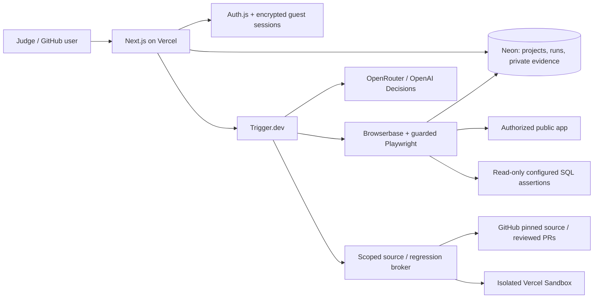

# PreFlight

AI browser testing with evidence you can inspect. PreFlight tests a deployed web
app in real browsers, checks configured persistence expectations, and saves
screenshots, observations and findings. Owners can request proposed fix PRs;
PreFlight never merges them automatically.

- **Live app:** https://www.trypreflight.dev
- **Example under test:** https://preflight-example.vercel.app
- **Submission:** [executive briefing](docs/executive-briefing.md),
  [architecture](docs/architecture.md), [financial model](docs/monetization.md)
- **Judge access:** use the invitation shared separately. No GitHub sign-in is
  required; each guest browser receives isolated run history.

## Implemented workflow

GitHub/Auth.js accounts, invitations and collaboration; persistent Neon projects,
runs and findings; guarded Browserbase/Playwright execution; configured database
assertions; fresh-context reproduction; pinned-source investigation and isolated
source regressions; private screenshots; cancellation; and owner-requested fix PRs.

A configured persistence check can require an exact success message. If a marked
submission is accepted but its SQL expectation fails, the worker repeats recorded
actions with a different marker in a fresh browser. Only two accepted, failed
assertions establish a persistence finding. A missing row, rejected submission,
stale toast or infrastructure error alone does not establish a bug.

The example waitlist deliberately clears its email field and shows success without
calling its save API. Guest demos include an explicit SQL expectation for it.
The example bug is intentionally retained.

**Limits:** arbitrary applications cannot always be confirmed automatically.
Reports preserve blocked prerequisites and unavailable providers. Use authorized
public previews and disposable test accounts. Payments, destructive actions and
account/security changes are blocked. The judge pilot has no per-user run quota.
Commercial pricing remains proposed until a payment account and genuine
checkout/webhook flow are verified; Stripe billing is not claimed as live.

## System design



The app uses **Neon Postgres and Auth.js**. Supabase is supported as a customer
database provider. `supabase/schema.sql` and `lib/supabase.ts` are legacy
scaffolding, not the active application schema or authentication system.
Current tables and migrations are in [lib/schema.ts](lib/schema.ts).

## Local replication

Use Node.js 24 (`nvm use`) and the committed npm lockfile:

```bash
npm ci
npx playwright-core install --with-deps chromium
npm test
npm run typecheck
npm run build
npm run test:integration
```

The integration suite uses actual local Chromium and PGlite Postgres databases
with controlled external-provider boundaries. No production credentials, paid
model calls or customer database writes are required. Set `CHROMIUM_PATH` to use
an existing Chromium; otherwise Playwright's installed browser is used.

For the web UI, copy `.env.example` to `.env.local`, configure your own development
Neon branch and GitHub OAuth app, and run `npm run dev`. The local callback is
`http://localhost:3000/api/auth/callback/github`. The shipped admin identity is
`james-software` in `lib/access.ts`; a fork must set its own owner. Public pages
build without live credentials; authenticated data operations need configuration.

See [local development](docs/local-development.md) for complete runtime setup and
the distinction between local fixtures and a public cloud preview. Cloud browsers
cannot reach localhost; the network guard must not be disabled to work around it.

## Runtime configuration

| Variable | Web | Worker | Purpose |
|---|---|---|---|
| `NEXT_PUBLIC_APP_URL` | Yes | Yes | Same canonical origin for web/broker calls; defaults to the live PreFlight URL |
| `DATABASE_URL` | Yes | Yes | Development or production application Neon database |
| `AUTH_SECRET`, `AUTH_GITHUB_ID`, `AUTH_GITHUB_SECRET`, `AUTH_URL` | Yes | No | Auth.js sessions and GitHub OAuth |
| `PROFILE_ENCRYPTION_KEY` | Yes | Yes | Same persistent base64 32-byte key in both runtimes |
| `TRIGGER_SECRET_KEY` | Yes | No | Correct environment's Trigger key |
| `BROWSERBASE_API_KEY`, `BROWSERBASE_PROJECT_ID` | Yes | Yes | Cloud browsers and optional profile capture |
| `OPENROUTER_API_KEY` | No | Yes | Driver and source review |
| `OPENAI_API_KEY` | No | Yes | Typed Decisions judgments |
| `BROWSER_AGENT_CONCURRENCY` | No | Optional | Shared provider capacity; defaults to one, not a user quota |
| `RESEND_API_KEY`, `INVITE_FROM_EMAIL` | Optional | No | Collaboration email |
| `BLOB_READ_WRITE_TOKEN` | Legacy only | Legacy only | Historical public-image retirement; new images use private Neon storage |

Generate independent `AUTH_SECRET` and `PROFILE_ENCRYPTION_KEY` values with
`openssl rand -base64 32`. Keep encryption keys stable; changing them without
migration makes saved connections unreadable. Never put a secret in a
`NEXT_PUBLIC_*` variable. `NEXT_PUBLIC_APP_URL` is intentionally a public URL.
For a fork, set its Trigger project in `trigger.config.ts`. See
[swarm setup](docs/swarm-setup.md) for preview/production routing. The driver is
`openai/gpt-6-luna`; typed judgments use `gpt-6-luna` via OpenAI Decisions.

## Verification and project map

GitHub Actions runs unit tests, types, production build, integration tests,
production dependency audit and a redacted full-history credential scan. Action
versions are pinned to SHAs. CI has no production credentials. The single
`.gitleaksignore` fingerprint is historical documentation prose, not a blanket
path exclusion. See [security hardening](docs/security-hardening.md).

- `app/`, `components/` — public UI, dashboard, APIs and typed React components
- `src/trigger/` — planning, browser, investigation and fix workers
- `lib/` — scoped access, data model, networking, providers and evidence
- `tests/` — unit and real-browser/database integration tests
- `docs/` — system design, operational guides and submission documents

Further guides: [judge demos](docs/judge-demo.md),
[database verification](docs/database-verification/README.md),
[authenticated testing](docs/authenticated-testing.md),
[collaboration](docs/project-collaboration.md),
[run review MCP](docs/run-review-mcp.md), [agent discovery](docs/agent-discovery.md).
