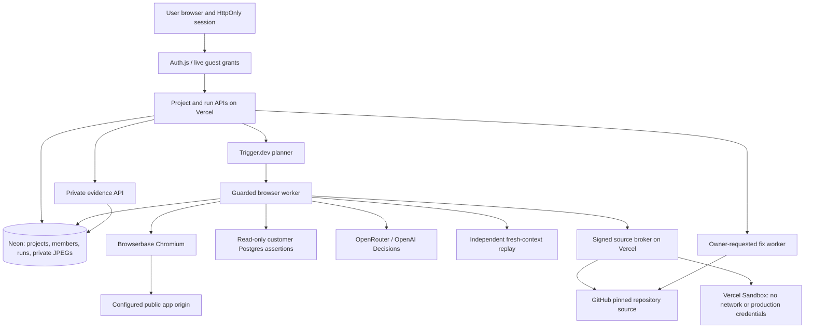

# Architecture and trust boundaries

PreFlight uses Next.js 16, React 19 and TypeScript on Vercel, with Neon Postgres.
Auth.js handles GitHub accounts; encrypted guest sessions are separately scoped.
Trigger.dev orchestrates Browserbase Chromium workers controlled by Playwright.
OpenRouter supplies the driver/reviewer; OpenAI Decisions supplies typed judgments.

## Run lifecycle

1. An owner/member selects an authorized branch or PR. Guests use only the
   prepared example's main branch. The server pins the SHA, snapshots authorized
   profiles/checks, persists a run and queues its worker.
2. Bounded public HTML discovery selects real anchors rather than preload scripts,
   stylesheets and icons. A matching explicitly configured persistence workflow
   replaces its duplicate generic form submission.
3. The worker allocates a browser within provider capacity. Every context blocks
   service workers and WebSockets and routes HTTP through DNS validation and an
   IP-pinned public connection. Navigation remains on the configured app origin.
4. The driver selects bounded actions; runtime policy independently enforces
   scope. Only authorized marked creates can write. Destructive, payment,
   messaging, account and security changes remain blocked.
5. Read-only SQL checks verify configured persistence expectations. If a newly
   visible configured success message accompanies a failed assertion, recorded
   actions are repeated with a different marker in a fresh context. Both accepted
   failures are required for a persistence finding. Missing rows alone do not
   establish defects.
6. Ordinary browser candidates also require independent reproduction. Unresolved
   goals can receive pinned-source review, safe browser follow-up and separately
   adjudicated source regressions in a disposable VM. Source behavior is explicitly
   distinguished from deployed behavior.
7. Reports retain completed observations if a provider fails. Owners can request
   a proposed fix PR and decide whether to merge it. Cancellation closes contexts
   and prevents new actions; it cannot undo an issued request.

## Isolation and data handling

Project APIs check current ownership/membership. Guest copies use scoped sponsor
connections but stay out of the sponsor's personal dashboard. Each guest sees only
their own workspace. Successful GitHub OAuth clears guest mode while preserving
the real account session. Guest repository writes are denied.

Connections use AES-GCM with owner/project/origin-bound authenticated data. GitHub
credentials remain server-side. Workers receive scoped snapshots and brokered
source, never secrets in generated tests. Run-agent bearer grants expire and
recheck current membership and guest grants.

Screenshots are private JPEG database records, not public object URLs. Their API
requires project access or a current bearer for that exact run and sends no-store
headers. Old public blobs are copied privately before a durable outbox deletes
them. Default evidence retention is 21 days.

## Scale and recovery

Web and worker tiers scale separately. Shared browser scheduling defaults to one
session and can increase to the provider plan's capacity; it is not a per-user
quota. The pilot has no per-user run limits. Model, browser, SQL, source and
sandbox work have independent time/byte/action bounds. Transient model responses
are retried; serialized worker failures are classified without leaking provider
bodies or connection URLs.

`lib/schema.ts` manages the active schema. Test schema changes against local
Postgres fixtures or an isolated Neon branch before release. Local tests use
controlled provider boundaries; live verification remains a separate release gate.
